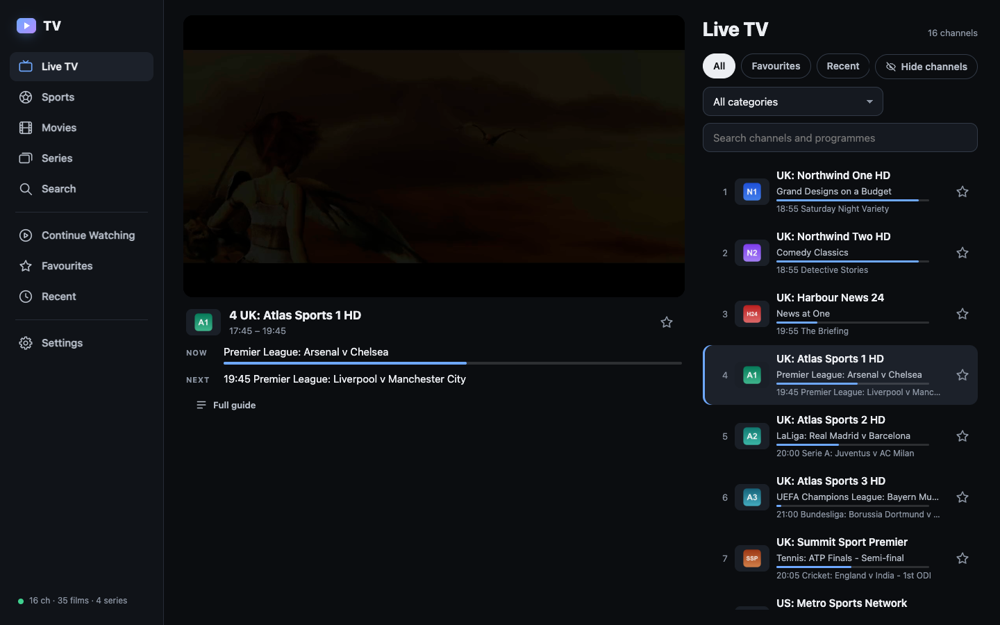
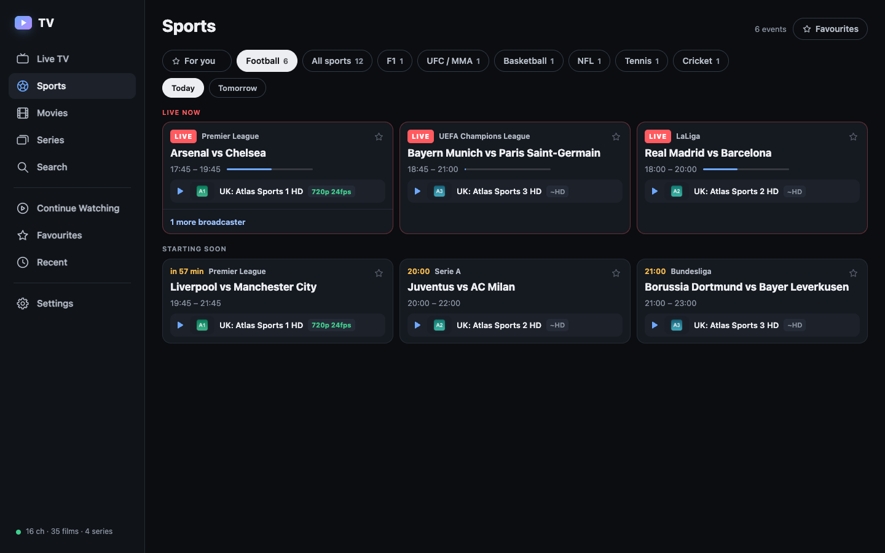
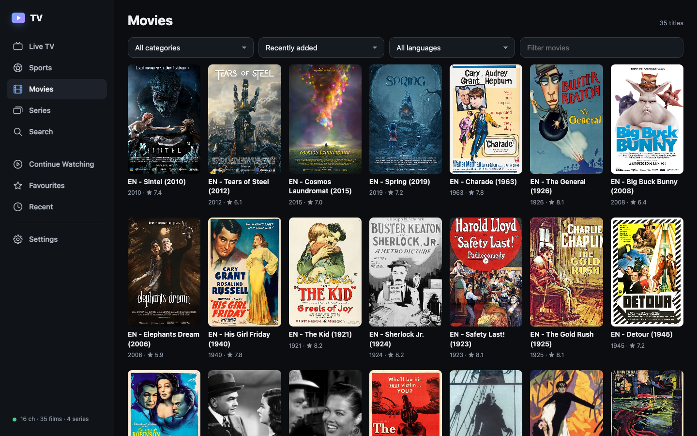
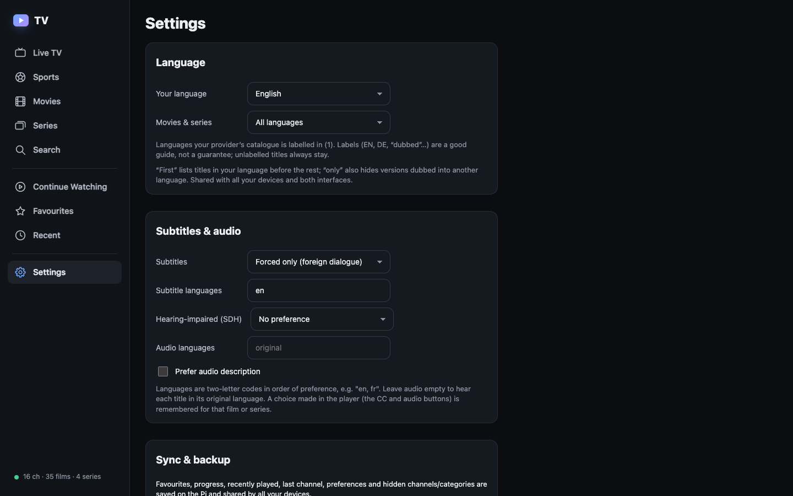

# Signal TV Classic

I built this to watch my IPTV subscription in a browser instead of a set of different apps. It runs on
a Raspberry Pi 5 at home and serves live TV, films and series to an iPhone, an iPad and a laptop, at
home or away.

It's a player, not a provider. It comes with no channels, playlists or credentials. You point it at an
M3U playlist or an Xtream Codes account you already pay for, and only you can use it: it sits behind
your own login.

This is the original, simpler version: one interface, one service, nothing else to run. The newer
version, with a redesigned interface, sports crests and more, is
[Signal TV](https://github.com/sbd1017/signal-tv), and it includes this interface as an option.

<table>
<tr><td width="50%"><br><b>Live TV</b>: the player, now and next, and the channel list</td>
<td width="50%"><br><b>Sports</b>: live and upcoming matches with their broadcasters</td></tr>
<tr><td><br><b>Movies</b> and series, by category, sort and language</td>
<td><br><b>Settings</b>: language, subtitles and audio, sync and backup</td></tr>
</table>

<sub>Shown with a demo provider: made-up channels, and free films (Blender's open movies and public-domain
classics). Image credits: [docs/screenshots/CREDITS.md](docs/screenshots/CREDITS.md).</sub>

## What it does

- **Live TV** with categories, favourites, recently played, now and next with progress bars, and a full
  guide for each channel. Channel up and down, previous channel, and a resume card for the last one.
- **Sports**: the day's matches from the guide as one card each, whatever each broadcaster calls them,
  with the best feed for your device first. Favourite teams and competitions, and optional alerts before
  kick-off.
- **Films and series** with posters, details, resume, mark as watched, next episode, an "Up next"
  countdown and an episode filter.
- **Search** across channel names and what's on now and in the next 24 hours. "Man Utd" finds
  Manchester United and "UCL" finds the Champions League.
- **Plays nearly anything** on an iPhone: streams the browser can't play (MKV, AC-3, MPEG-2, interlaced
  feeds) are remuxed or converted on the Pi with ffmpeg, subtitles and audio tracks included.
- **Your library everywhere**: favourites, progress, recently played and settings are kept on the Pi and
  shared by every device, with export and import.
- Works as a home-screen app on iPhone, with picture-in-picture, AirPlay, lock-screen controls and
  keyboard shortcuts on a laptop.
- Hide the channels and categories you never watch, on every device at once.
- Daily backups, optional Telegram alerts when something breaks, and an `iptv` command for everything
  you'd do over SSH.

Provider credentials and stream addresses never reach the browser. It sees only opaque IDs, and
playback goes through short-lived signed links.

## Built with

Python 3.11, FastAPI, httpx and ffmpeg on the server; plain JavaScript modules in the browser (no
framework, no build step), with hls.js for playback. No CDNs, web fonts from elsewhere, or analytics.

## Trying it locally

You need Linux (or a Pi), Python 3.11 and ffmpeg. The demo provider serves a few generated test channels,
films and a series, so you can try everything without a real subscription.

```bash
sudo apt install ffmpeg fonts-dejavu-core
python3 -m venv .venv
.venv/bin/pip install -r requirements.txt

# the demo provider on 127.0.0.1:8791
bash demo/make-media.sh demo/media
DEMO_MEDIA=demo/media .venv/bin/python demo/demo_provider.py &

# the app on 127.0.0.1:8790, pointed at the demo provider
mkdir -p var
printf 'IPTV_PROVIDER_TYPE=m3u\nIPTV_M3U_URL=http://127.0.0.1:8791/playlist.m3u\nIPTV_EPG_URL=http://127.0.0.1:8791/epg.xml.gz\n' > var/tv.env
TV_CONFIG=var/tv.env STATE_DIRECTORY=var/state CACHE_DIRECTORY=var/cache TV_LIVE_DIR=var/live \
  TV_WEB_DIR=web .venv/bin/python -m tvapp
```

Then open http://127.0.0.1:8790/tv/. This setup has no login, so keep it on your own machine.

## Running it on a Pi

[docs/OPERATIONS.md](docs/OPERATIONS.md) is the full manual: the systemd services, the nginx setup
(login, rate limits, headers), the configuration file, playback and how streams are converted, sync and
backups, and the `iptv` command. In short:

1. Copy the repo to the Pi and run `deploy/install.sh`. It installs the app in `/opt/signal-tv-classic`.
2. Install the systemd units and nginx snippets from `deploy/`.
3. Put your provider in `/etc/signal-tv-classic/tv.env` (`iptv config`, or start from
   `tv.env.example`), then `iptv reload`.

Put it behind HTTPS and a login before it faces the internet. The repo's nginx files assume Basic Auth
and a Cloudflare Tunnel in front, but any reverse proxy that does the same will work.

## Tests

```bash
.venv/bin/python -m unittest discover -s tests
TV_TEST_PYTHON=.venv/bin/python node --test tests/*.mjs
```

## Licence

MIT, see [LICENSE](LICENSE). hls.js (`web/static/vendor/`) is Apache 2.0; its licence file sits next to
it.
